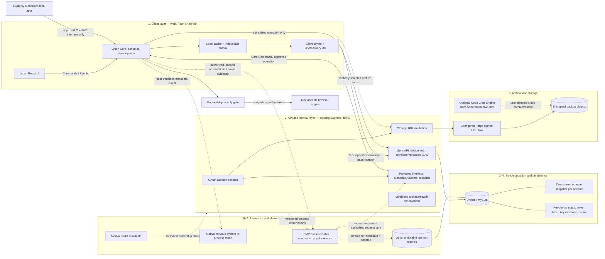

# Lycon Backend Architecture Proposal

**Status:** Design proposal; no implementation approved or performed
**Baseline reviewed:** `main` at `ff30b7bcf198ba5006844d5ef4c7f02e614ac229`
**Recovery reference:** `stable/2026-10-24-green` exists locally and on `origin`
**Review date:** 2026-10-24

## Evidence labels

- **Verified** means directly visible in the checked-in source, package metadata, tests, or repository configuration.
- **Proposed** means recommended target behavior, not a claim about current behavior.
- **Unresolved** means evidence does not settle the decision; the proposal gives a safe default pending review.

## 1. Executive summary

**Verified:** The current constitutional authority is [LYCON_CORE_CONSTITUTION_v0.3.md](./LYCON_CORE_CONSTITUTION_v0.3.md); its stated precedence is above the code until formally amended. It assigns canonical browser state, identity, policies, capabilities, privacy/exposure state, events, and data boundaries to Lycon Core; Core alone validates Commands and mutates state, and the EngineAdapter is the only browser-engine gate. The current implementation and tests do not establish that every constitutional invariant is fully enforced across every platform or process.

**Verified:** Lycon also has a React/Vite frontend, Express/tRPC API, OAuth-backed sessions, Drizzle/MySQL persistence, an opt-in revisioned sync endpoint, a Forge-backed storage helper, Core/EngineAdapter architecture, and Tauri and Android shells. The checked baseline passed `pnpm test` (161 tests), `pnpm check`, and `pnpm build`; the build emitted existing missing-analytics-variable and large-chunk warnings. The live production service, database, and storage account were not independently inspected.

**Proposed:** Keep Lycon Core as the sole owner of canonical state, identity, effective policy, capabilities, privacy/exposure, and state transitions. Surfaces, local applications, agents, backend workers, UPMP, and engine implementations must use approved Core Commands/interfaces; none gains authority by observing state or by being integrated.

**Proposed:** Define UPMP's scope as cross-process execution integrity and operational assurance for declared, instrumented Lycon tasks—not just infrastructure health. It verifies task contracts, causal evidence, permitted transitions, completion/postconditions, and failure outcomes across covered frontend, Core, backend, sync, storage, engine-adapter, background, and integrated local-application paths. Protected actions must be prevented at Core/interface enforcement points before execution; UPMP's later observation is supplementary, not the permission gate. Ordinary browsing must not depend on an external UPMP service.

**Proposed:** Treat privacy as multiple scoped capability and exposure dimensions, not a single flag. In particular, preserve Constitution v0.3's private-session-by-construction rule: private sessions have zero retention and lack persistent-storage, persistent-cookie, credential-access, and persistent-download capabilities. Network access, local persistence, local-app access, public disclosure, sync, and user-selected archives require distinct policy decisions.

**Proposed:** Keep the API out of the cryptographic trust boundary for E2EE sync. Use Craft Engine only for deliberate, user-selected archival in supported trusted Node environments; live sync remains a separate encryption and key-management decision. Reuse Manya contracts and suitable infrastructure, but do not confuse declarations or event delivery with Core runtime enforcement, authoritative state, or durable audit.

## 2. Verified current architecture

| Area | Evidence in the current tree | What this proves—and does not prove |
|---|---|---|
| Client and local state | `client/src/pages/Home.tsx`, `client/src/lib/trpc.ts`, `vite.config.ts` | **Verified:** React/Vite UI state is persisted through browser storage; sync is opt-in and the client uses tRPC. It does not prove that every local record is safe to sync. |
| API | `server/_core/index.ts`, `server/routers.ts`, `server/_core/context.ts`, `server/_core/trpc.ts` | **Verified:** Express serves tRPC, health, OAuth callback, and storage routes; protected procedures require an authenticated user. |
| Identity | `server/_core/oauth.ts`, `server/_core/sdk.ts`, `server/_core/cookies.ts` | **Verified:** OAuth callback and signed session handling are implemented. These account credentials are not encryption keys and do not provide E2EE. |
| Persistence | `drizzle/schema.ts`, `server/db.ts`, `drizzle.config.ts` | **Verified:** MySQL tables currently cover users and one browser-sync snapshot per user. Snapshot payload is text, and revision is an `int`. No device registry or key envelope records exist. |
| Synchronization | `server/routers.ts`, `shared/validators.ts`, `server/db.ts`, `client/src/pages/Home.tsx`, `server/sync.router.test.ts` | **Verified:** Sync reads and writes are account-protected. Input validation currently checks only non-negative base revision and payload string length (2–60,000); it does not parse or schema-validate the JSON. The database function reads the revision and then writes separately, so simultaneous writers can pass the same check. |
| Current conflict handling | `client/src/pages/Home.tsx`, `server/lib/mergeById.ts` | **Verified:** The client merges some collections by ID after conflict. The current snapshot has no deletion tombstones or per-field versions; the conflict path does not merge every field it uploads. This is not a reliable offline multi-device merge protocol. |
| Local backup | `client/src/pages/Home.tsx` | **Verified:** User-triggered export creates a version-1 plaintext JSON file containing bookmarks, history, and downloads (including the download `content` field). Import merges selected collections into local state. It is not an encrypted or cryptographically verified archive. |
| Storage | `server/storage.ts`, `server/_core/storageProxy.ts`, `server/_core/env.ts` | **Verified:** Lycon requests upload/download URLs from a configured Forge API and uses a presigned S3-compatible URL for upload; the GET proxy obtains a signed URL and redirects. Storage is used by image generation. The existing flow is Forge-specific and does not establish Lycon per-user authorization or ownership semantics for future backup objects. |
| Craft Engine | `Daemon22/craft-engine` package manifest and `src/lib/craft/*` | **Verified:** The package exports `nano`, `macro`, streaming operations, archive/extract and integrity/fixity APIs. The current API accepts `Buffer` and Node streams; package metadata requires Node `>=22.15.0`. Its AES-GCM/passphrase and key-based helpers are Node-side APIs. These exports are not a browser or Android compatibility guarantee. |
| Craft strategy restriction | `Daemon22/craft-engine/src/lib/craft/nano.ts` | **Verified:** When strategy 12 is disallowed, code calculates a fallback candidate but does not use its data; it subsequently assigns `result.data` from the original result. The comment also says the fallback is not actually selected. The current behavior therefore does not enforce the stated restriction. The checked `craft-hardening` tests cover round-trip verification, not this restriction. Do not rely on restricted-tier fallback until it is fixed and tested. |
| UPMP | `Daemon22/UPMP/UPMP/contracts.py`, `closed_loop.py`, `tests/`, and `README.md` | **Verified:** The Python project has typed observations/state, schemas, verification policies, allow-listed action dispatch, and a closed-loop workflow runner. Its README explicitly documents in-memory audit, synchronous handlers, absent persistent audit/cancellation/timeout guarantees, and handler-enforced idempotency. |
| Manya toolkit and nervous system | `Daemon22/Manya/packages/toolkit/`, `packages/nervous-system/`; Lycon `package.json` and lockfile | **Verified:** The installed versions are `@manya-hael/toolkit` 0.2.0 and `@manya-os/nervous-system` 1.1.0. Toolkit manifests express identity, ownership, hands-off capabilities, and sync channels, but do not include a contract version field. The nervous system is an in-process event fabric with a bounded recorder, not durable or distributed messaging. Lycon declares these packages but the Express request path does not currently use them. |
| Manya adapters | Lycon `manya/index.js`, `manya/test/*`; `Daemon22/Manya/tools/upmp/manya/` | **Verified:** Lycon's local adapter forwards events to a supplied bus; its fallback reaches into bus internals and swallows subscriber errors. This adapter is not wired into the current Express/tRPC backend. Manya's `tools/upmp/manya/` adapter describes UPMP-ADT activity/stuck-point/discovery tracking; it is a separate integration from the `Daemon22/UPMP` process-integrity framework. |
| Core Constitution | `docs/LYCON_CORE_CONSTITUTION_v0.3.md` | **Verified:** v0.3 states it outranks code until formally amended. Core owns canonical browser state and is the sole authority that validates Commands and mutates state; EngineAdapter is the only engine gate; private sessions lack persistence/cookie/credential/persistent-download capabilities by construction. These constitutional rules are authority, not proof of complete implementation coverage. |
| Deployment | `Dockerfile`, `.github/workflows/*`, `README.md` | **Verified:** A Node 22 container build and Tauri/Android release workflows are present. **Unresolved:** No deployment account, running service, production MySQL, Forge configuration, or live website behavior was verified. |

## 3. Component capability inventory

| Component | Existing capability | Target responsibility |
|---|---|---|
| Lycon Core | **Verified (constitutional):** Constitution v0.3 assigns canonical state, identity, policy, capabilities, privacy/exposure, events, and transitions to Core. Current code has Core and Command/Event abstractions. | **Proposed:** Sole policy decision and state-mutation authority for every integrated process. Its canonical snapshot, Commands, Events, and capability grants remain authoritative; no observer or adapter maintains a competing state model. |
| Lycon surfaces and clients | **Verified:** React/Vite local browser state, optional account sync, local JSON export/import; Tauri and Android shells are present. | **Proposed:** Render Core state, issue Commands, and make explicitly scoped user choices. Local UI/storage state may cache Core state but must not become an independent authority or bypass policy. |
| Express/tRPC | **Verified:** OAuth/session, protected API, sync get/put | **Proposed:** Account/device authorization and persistence boundary; for protected operations, authenticate and validate requests, then route state changes through Core-approved commands/interfaces. Snapshot CAS, envelope validation, signed storage URL mediation, and health observations remain separate responsibilities. |
| Drizzle/MySQL | **Verified:** User and current snapshot persistence | **Proposed:** Transactional revision coordination, device credentials/status and cursors; later, minimal durable operational audit if required |
| Forge storage integration | **Verified:** Forge presigning and S3-compatible transfer | **Proposed:** Encrypted archive-object storage after ownership, auth, quota, retention, and signed-URL policy are verified |
| Craft Engine | **Verified:** Node archive/compress/encrypt/restore/verify APIs | **Proposed:** Optional, deliberate archival operation over content explicitly selected by the user in a supported trusted Node environment; never an automatic archive of all browsing activity or live-sync encryption layer |
| UPMP | **Verified:** Python observations, typed state/schema, verification policies, risk assessment, allow-listed action dispatch, and workflow primitives | **Proposed:** Cross-process assurance for declared and instrumented tasks. It observes and verifies process evidence; Lycon Core and protected interfaces enforce policy and state transitions. Not universal control of arbitrary processes. |
| Manya toolkit | **Verified:** Capability ownership manifests and overlap checking | **Proposed:** Reusable contract declarations and build/test ownership checks; declarations do not grant capabilities or enforce runtime policy |
| Manya nervous-system | **Verified:** In-process event routing, recorder, metrics | **Proposed:** Best-effort, metadata-only local telemetry after committed actions |

## 4. Proposed target architecture

Solid paths denote existing, verified connections. Dashed paths denote proposed integrations. The boxes are logical responsibilities; this does not require separate services.



### Component and data boundaries

1. **Lycon Core — Verified constitutional authority; implementation coverage unresolved:** Owns the canonical browser object graph, identity, policies, effective capabilities, privacy/exposure state, event history, and state transitions. It validates Commands and is the only component that mutates canonical state or emits Core Events. UI, backend, local applications, agents, UPMP, and engine code do not create parallel authority.
2. **Client/surface layer — Verified/Proposed:** Surfaces render Core state and issue Commands. Local persistence is only for capabilities granted by Core; the outbox is a proposed sync queue, not a second canonical state model. UI access to an integration or feature does not itself grant data access.
3. **Engine boundary — Verified constitutional rule; conformance unresolved:** Every engine operation crosses EngineAdapter. Core computes effective capabilities and issues scoped capability tokens; the concrete engine never receives identity records or direct authority. EngineAdapter attaches only for visible tabs and detaches when hidden/destroyed, per Constitution v0.3.
4. **API and identity — Verified/Proposed:** OAuth identifies the account; API middleware authenticates requests and checks endpoint policy. Any protected mutation is dispatched through an explicitly authorized Core/command interface rather than directly changing Core state or engine state.
5. **Synchronization — Proposed:** The API treats encrypted payload bytes as opaque and uses device authorization plus atomic revision handling. Client decrypt/merge/encrypt operations remain under Core privacy and sync policy; sync is not a permission to share every data category.
6. **Persistence — Verified/Proposed:** MySQL stores account/sync/device metadata. It is not the canonical browser state authority; server-persisted snapshots are encrypted replicas, subject to Core's sharing policy.
7. **Archive and storage — Verified/Proposed:** Forge remains the configured storage integration. Craft is an optional user-directed archival tool in trusted Node environments. Storage endpoints enforce object ownership and only accept archive data the user explicitly chose to export.
8. **Process assurance — Proposed:** UPMP observes versioned, authorized process evidence from covered interfaces and verifies it against declared task contracts. Core and the relevant interface enforce capabilities and transitions before protected actions. UPMP's recommendation cannot directly mutate Core.
9. **Shared coordination — Proposed:** Toolkit manifests declare ownership/contracts and are checked at build/test time; the nervous-system fabric carries best-effort telemetry. Neither is runtime authorization, Core state, a distributed queue, or durable audit.

## 5. Data flows and trust boundaries

### Live synchronization

1. **Proposed:** User signs in using the existing OAuth flow. The account session can enroll a device but is not itself sufficient to read or write synchronization data after a device credential is issued.
2. **Proposed:** The client fetches the current encrypted envelope and revision using its active device credential. It decrypts locally and validates the decrypted document against the supported client schema.
3. **Proposed:** The client applies remote changes to its local document, keeps local pending operations, resolves conflicts deterministically, and writes a new envelope with `baseRevision`.
4. **Proposed:** The API confirms that the device remains active, performs one atomic compare-and-swap, and returns the next revision. On conflict it returns the current opaque envelope, not a merged result.
5. **Proposed:** The client decrypts and merges the returned/current document and retries from the new revision. A bounded retry count prevents hot-looping; it does not discard local operations.
6. **Proposed:** Only after the database commit does Lycon emit a telemetry event. A telemetry failure never rolls back a committed sync write.

### Backup transfer

1. **Proposed:** The client explicitly selects categories, creates an archive locally, encrypts it, validates its own archive, and uploads only ciphertext bytes.
2. **Proposed:** The API authorizes the account/device and obtains a short-lived, object-scoped upload or download URL from the chosen provider.
3. **Proposed:** The client verifies the downloaded archive's cryptographic integrity and compatibility before previewing or importing data.

### Trust boundary summary

- **Verified:** OAuth/JWT protect account identity and API access; HTTPS is not an end-to-end encryption design.
- **Proposed:** Plaintext exists only in the user's client process and local storage while the browser feature is in use. A client compromise, malicious extension/native shell, same-origin script injection, or compromised device can access plaintext/keys; E2EE does not solve those threats.
- **Proposed:** The API, MySQL, Forge, operational telemetry, and UPMP see account/device metadata, ciphertext, approximate sizes, timestamps, revisions, and service health—not decrypted browser content or recovery keys.
- **Proposed:** Encrypt before any payload reaches Lycon's server or object store. Storage-side encryption and TLS are additional protections, not substitutes for client encryption.
- **Proposed:** Every path from a surface or process to canonical state, storage, sync, an engine, or a local application has an enforcement point that checks Core-issued authority before the protected action. UPMP evidence supports assurance; it does not grant authority.
- **Proposed:** When a protected operation requires assurance and evidence is missing, stale, contradictory, or inconclusive, the enforcing interface denies or safely holds that operation and records a rejected/indeterminate outcome. It must not broaden permissions, substitute a success result, or mutate Core state. Ordinary browsing remains available where the specific action does not require the unavailable assurance.

### Process-assurance and privacy-enforcement view

**Authority and coverage**

- **Verified (constitutional):** Lycon Core owns canonical browser state, identity, policy, capabilities, privacy/exposure state, events, and transitions. Core validates Commands and mutates state; the UI, agents, extensions, and integrated processes do not bypass it. EngineAdapter is the only engine interface.
- **Proposed:** Assurance coverage is scoped to declared tasks and protected processes that have an explicit Core command/interface boundary, authenticated process identity, capability checks at the point of use, complete causal event instrumentation, and defined terminal/postcondition checks. Coverage must also include indirect paths through frontend state, Core, backend, synchronization, storage, EngineAdapter/engine, background workers, and integrated local applications.
- **Unresolved:** Constitution v0.3 does not fully specify permissions for local applications or public/external disclosure. Those need explicit policy/constitutional design before Lycon may claim those flows are covered. Do not reinterpret or amend v0.3 through this proposal.
- **Boundary:** Lycon cannot guarantee control over arbitrary external processes, uninstrumented applications, compromised operating systems, or network observers. Such processes remain outside the assurance claim unless an approved integration mediates their capabilities and emits verifiable evidence. A process is not “covered” merely because it is visible to a monitor.

**Proposed process/task assurance contract**

Each in-scope task carries or resolves to a versioned contract containing the fields applicable to the task:

| Contract element | Required meaning |
|---|---|
| Task identity and intent | Unique task/command ID, authenticated author/participant, declared purpose, intended outcome, and idempotency/correlation ID where applicable |
| Scope and authority | Resources and data categories in scope; permitted operations; required capability grants; expiry/conditions; explicit exclusions |
| Privacy/exposure policy | Network permission, private-session status, local persistence rules, local-application grant, public disclosure scope/recipient, sync category/device scope, and archive selection/destination/protection as separate dimensions |
| Process model | Expected states and allowed transitions, checkpoints, dependencies, timeout/deadline, and retry bounds |
| Terminal outcomes | Separate `completed`, `blocked`, `rejected`, `failed`, and `cancelled` states; success requires all declared completion conditions and verifiable postconditions |
| Evidence | Causally traceable Core Command and Events (including `commandId`), process/interface identity, capability decision, timestamps/sequence, checkpoint results, data-flow category/destination metadata, and postcondition evidence sufficient to evaluate compliance without logging private content |
| Failure policy | Explicit behavior for missing/stale/inconsistent evidence, denied capability, dependency failure, partial side effects, cancellation, deadline expiry, and bounded retries |

**Proposed observation, verification, and enforcement flow**

1. The requesting surface/process submits intent as a Core Command with its participant identity and task reference. It cannot assert capabilities for itself.
2. Core resolves current identity, policy, privacy dimensions, domain limits, and effective capability set. The relevant gate (Core command handler, API endpoint, storage broker, sync endpoint, EngineAdapter, background-task dispatcher, or local-app broker) checks that grant immediately before the protected operation.
3. If authorized, Core transitions state through its validator, emits causally linked Events, and issues only the scoped capability token needed for the operation. The engine receives capabilities, not identity or hidden Core state.
4. UPMP receives a permitted, minimized observation stream/report through an approved interface. It compares observed states, transition order, checkpoints, dependencies, capability decisions, and declared data-flow classifications with the contract.
5. UPMP identifies incomplete task paths (missing terminal event/checkpoint), unauthorized transitions, unexpected capability use, out-of-scope data destinations, missing causal links, direct-engine/storage/database access paths, attempts to bypass a broker, and postconditions that do not hold. Detection evidence can prompt containment/alerting, but only a Core/interface gate can prevent or authorize the action.
6. A task is successful only when the contract's completion conditions and postconditions verify. Process exit, HTTP response, “not throwing,” or a handler return value alone is insufficient. A denied action is `rejected` or `blocked`; cancellation and failure remain distinct, auditable outcomes.
7. A deviation may trigger a Core-routed, explicitly authorized restriction or recovery request. UPMP cannot write Core state, command an engine directly, or access hidden Core state. Core revalidates the request and may reject it.

**Safe behavior when assurance is unavailable**

- **Proposed:** Ordinary browsing and commands whose policy does not require UPMP evidence continue under Core policy; telemetry/assurance unavailability does not grant additional capabilities.
- **Proposed:** Protected actions with a declared assurance prerequisite fail closed before side effects if the contract, fresh evidence, or verifier decision is unavailable or inconclusive. Return `blocked`/`indeterminate`, preserve local user data, and expose a retry/manual-review path.
- **Proposed:** Explicit emergency or recovery exceptions, if any, require an independently authorized Core policy, bounded scope, operator confirmation, durable evidence, and postcondition verification. No implicit “UPMP down, proceed” fallback.
- **Verified limitation:** UPMP's current runner alone does not supply durable audit, asynchronous cancellation, enforceable timeouts, or external idempotency. Lycon's wrapper/enforcement boundaries must supply those properties before a protected process relies on them.

**Privacy and exposure dimensions**

These are independent policy axes and must not collapse into one `private`/`online` boolean:

| Dimension | Proposed policy question and enforcement surface |
|---|---|
| Network connectivity / external resources | Is the Den-to-Forest Threshold open, and is `CanNetwork` granted for this session and destination? Core controls the state transition and the engine/network gate. |
| Private browsing session | Is this a private session with zero retention? By Constitution v0.3, `CanPersist`, `CanStoreCookies`, `CanAccessCredentials`, and persistent `CanUseDownloads` are absent by construction. EngineAdapter, browser engine, local stores, sync, and backup paths must not recreate those capabilities. |
| Local persistence / personal information | Which local data category may this operation read or persist, for what purpose, and where? A grant for bookmarks does not grant history, credentials, downloads, or other records. |
| Local applications / integrated processes | Which named app/process, operation, data category, duration, and destination has the user explicitly authorized? The grant must be scoped, revocable, and checked at the broker/Core command boundary. |
| Disclosure to websites/services/public audiences | What selected content is disclosed, to which named recipient/audience, for what purpose, and for how long? Opening network access does not authorize page-context disclosure. Public exposure changes require an explicit scoped Core command and visible confirmation. |
| Synchronization / device sharing | Which categories and devices are eligible, under which account/key epoch, and can the receiving device decrypt? Sync consent does not imply public disclosure or archive inclusion. |
| User-selected archive | Which exact content/categories are included, which destination is selected, and whether/how the archive is protected? Archive creation is a separate user operation, not an automatic consequence of browsing or sync. |

**Proposed:** Grants are least-privilege and resource/category-specific. Granting one data category or local application does not authorize unrelated personal information. Permission reduction, revocation, and exposure changes are validated Core state transitions; the Core emits the corresponding causally linked event. Enforcement must apply consistently across frontend, backend, storage, sync, shell, local-app broker, EngineAdapter, and concrete engine interfaces.

**Unresolved constitutional/policy gaps:** Constitution v0.3 establishes private-session capability reduction and the Threshold/engine/Core boundaries, but does not define a complete local-application permission schema, public disclosure recipients/scopes, consent expiry/revocation protocol, or cross-process data-flow classification vocabulary. Before implementation, decide whether these require a formal constitutional amendment or can be specified as Core policy under the current articles. This proposal does not amend the Constitution.

## 6. Synchronization protocol and conflict-resolution design

### Authority and eligible data

- **Verified (constitutional):** Lycon Core, not a UI surface, local cache, server, or archive, is the canonical authority for browser state and valid transitions.
- **Proposed:** A device may keep a local durable cache/outbox only for data and storage capabilities granted by Core policy. Offline edits are pending Core commands/operations for later reconciliation; the client cache is not a competing canonical state model. A successfully committed encrypted account snapshot is a shared replica/convergence point, not a replacement for Core.
- **Proposed:** Sync is opt-in at account level and separately configurable by category and device. Recommended initial categories: bookmarks; history only after explicit opt-in; selected non-sensitive preferences. Open tabs are an explicit “handoff/open tabs” option and are never synced if private. Exclude passwords, cookies, credentials, local file paths, download contents, private tabs/history, and telemetry by default. Core validates that a sync operation does not exceed its category/device grants.
- **Verified:** The current client snapshot includes bookmarks, history, download metadata, tabs, active tab id, and settings; the separate local backup includes download content. These fields should not automatically define the target sync contract.
- **Unresolved:** Whether history and non-private open tabs should be account-sync categories by default. Safe default: bookmarks only, with explicit opt-in for history/tabs/preferences.

### Revision model and atomic write

- **Verified:** Current state is one `browser_sync_snapshots` row per `userId`, with a `revision` and text payload. `userId` has a unique index.
- **Proposed:** Retain one current snapshot per account for the first hardened version. Represent API revision as a monotonically increasing 64-bit integer; keep client document schema version, cryptographic envelope version, and key epoch distinct from that global revision.
- **Proposed:** A write carries `{ deviceId, baseRevision, clientCommitId, envelope }`. Success means the server atomically changed revision `n` to `n+1`; conflict means no write occurred and the client receives the current revision/envelope.
- **Proposed:** Replace “read current revision, then write” with an atomic conditional update equivalent to `UPDATE ... WHERE user_id = ? AND revision = ? AND key_epoch = ?`, and treat exactly one affected row as success. Handle first-write insert races using the existing unique account key; a duplicate insert becomes a conflict/re-read, never an unconditional overwrite.
- **Proposed:** Device-active validation, snapshot CAS, and cursor update must share one database transaction/locking discipline. Revocation must serialize against sync writes, so an already-revoked device cannot win a race after an earlier out-of-transaction check. Drizzle supports transactions; exact locking syntax and affected-row behavior must be confirmed against the deployed MySQL version before implementation.
- **Verified:** Drizzle's documented transaction API supports grouping writes into one commit/rollback unit. **Unresolved:** Production MySQL version and isolation settings are not available in this audit.

### Deterministic merging and tombstones

- **Proposed:** Give each replicated item a stable ID and each field mutation a Lamport version `(counter, deviceId)`. A device increments its counter above the maximum it has observed. Merge field values by lexicographic `(counter, deviceId)` ordering, not wall-clock time. Ties are deterministic across platforms.
- **Proposed:** Represent deletion as a versioned tombstone for the same stable item ID. A tombstone beats older field writes; an intentional restore is a new, higher-version operation. Merge history as append-only entries with stable event IDs and deduplicate identical IDs.
- **Proposed:** Keep tombstones in the encrypted document while any registered, non-revoked device may still have an older copy. Do not compact them in the first version. Later compaction requires device acknowledgements plus a `minimumAcceptedRevision`/generation rule: devices below the compaction floor must fetch the current state and explicitly preview/rebase local-only changes before any upload. Do not silently accept a stale snapshot that can resurrect deleted items.
- **Proposed:** Per-device UI state such as active tab should stay device-local. Account preferences should be an explicit allowlist. Conflicting edits to critical user-authored records should have a user-visible recovery path rather than an implicit destructive “last writer wins.”

### Offline behavior and device revocation

- **Proposed:** Persist local edits and pending sync work in IndexedDB transactions. On reconnect, download latest, decrypt/validate, merge the remote snapshot with the local base plus pending operations, then CAS. Keep pending work until the server confirms a revision that includes it.
- **Proposed:** Record a unique device ID, display name/platform, creation and last-seen timestamps, last acknowledged revision, active/revoked state, public key or wrapped key material, and a hash of a random device credential. Never store a bearer credential in plaintext.
- **Proposed:** Enroll devices only after account authentication plus either explicit approval from an existing device or recovery-material proof. The server stores key envelopes for authorized devices, not plaintext account keys.
- **Proposed:** Require the per-device credential for every sync read/write; do not fall back to an account session for sync data. Revocation marks that device unusable and invalidates its credential. Key rotation follows revocation of a device suspected to have copied key material.
- **Proposed:** Revocation cannot erase data or keys already copied to a device. It prevents further server access; rotation prevents a holder of the old key from reading future ciphertext if they obtain it.
- **Unresolved:** Device expiry policy, pairing UX, supported platform keystores, and cryptographic key-wrapping algorithm require product/security review. Safe default: no automatic expiry; user can revoke, and stale devices must re-fetch before writes.

### Failure and recovery behavior

- **Proposed:** Database unavailable: return an explicit retryable API error; preserve local state/outbox; never advance local revision or show success.
- **Proposed:** Concurrent stale write: return a conflict response with the latest envelope; never perform last-writer overwrite on the server.
- **Proposed:** Malformed envelope: reject before persistence if envelope fields/encoding/size/version are invalid. A structurally valid but unauthentic ciphertext can only be rejected by a client on decryption; do not let that failure erase local state.
- **Proposed:** Partial database failure: snapshot, device cursor, and idempotency state either all commit or all roll back. A client retry after a lost response is safe by reloading the current revision and merging; `clientCommitId` helps diagnose/reconcile retries.
- **Proposed:** Invalid decrypted schema or unsupported key/schema version: quarantine the remote copy locally, retain the user's local data, report an actionable error, and require a supported migration or user decision. Never replace local state with parse fallback/defaults.
- **Proposed:** Keep one latest snapshot initially; do not add an operation-log table unless payload size, merge cost, or recovery requirements demonstrate that it is needed. The current single-row model is adequate as a server CAS slot, but the client document must carry merge versions and tombstones for offline convergence.

### Synchronization invariants

1. At most one write can advance a given `(userId, revision, keyEpoch)`; concurrent writers cannot both report success.
2. A failed/conflicted write never modifies the stored envelope or the client's acknowledged revision.
3. Every accepted write is authorized by a currently active device credential at commit time.
4. A revoked device cannot read or write a later revision, even if its account OAuth session remains valid.
5. Client merge is deterministic and commutative for supported replicated fields; replaying a commit is idempotent.
6. A deletion tombstone cannot be replaced by a lower/equal-version update; stale devices cannot auto-upload across a compaction floor.
7. Private data and excluded categories never enter the sync encryption request.
8. A database/API outage never loses local edits or presents false sync success.
9. The server persists only supported, size-bounded envelope formats; clients never accept an unauthenticated/decryption-failed envelope as valid state.
10. Sync data is not logged in plaintext; errors/logs contain IDs and safe diagnostics only.

### Necessary persistence changes—not a broad schema rewrite

| Record | Need | Minimum fields/constraints | Transaction requirement |
|---|---|---|---|
| Current `browser_sync_snapshots` row | **Verified:** already provides one current snapshot per account. | **Proposed:** retain unique `userId`; widen revision to unsigned/big integer; store envelope bytes/serialized envelope, format version, key epoch, and updated timestamp. A JSON `payload` could temporarily hold the envelope, but an explicit binary/envelope shape is clearer and avoids treating ciphertext as JSON user state. | Atomic CAS on `userId + expected revision + key epoch`. |
| `sync_devices` | **Proposed:** required for independent revocation, device-scoped authorization, acknowledgements, and key delivery. | FK to user; unique `(userId, deviceId)`; token hash; public-key/key-envelope metadata; key epoch; status/revoked timestamp; created/last-seen/last-ack revision. No plaintext key or reusable token. | Lock/check device and CAS snapshot in one transaction; revocation takes the same device-row lock. |
| `sync_commit_receipts` | **Unresolved/optional:** not needed for initial correctness if clients reconcile by re-fetch + merge. Add only if observed lost-response retries need durable idempotency receipts. | `(userId, clientCommitId)` unique, committed revision, device ID, timestamp; never store plaintext. | Receipt and snapshot update commit atomically. |
| `ops_runs` | **Unresolved/optional:** only needed when durable operational audit cannot be provided by an existing verified store. | Run ID, source/version, observation summary, policy version, result, timestamps, action IDs/approval; avoid user content and secrets. | Persist before/after any authorized action; record failure distinctly. |

## 7. Encryption and key-management design

### Recommended trust model

- **Proposed:** Encryption and decryption happen in the Lycon client before network transfer and after download. The API, database, Forge, and UPMP do not receive plaintext or decryption keys.
- **Proposed:** Use a random account sync key generated with a cryptographically secure client RNG. Encrypt each versioned sync document with an audited authenticated-encryption implementation. Bind format version, key epoch, and document schema version as authenticated associated data.
- **Proposed:** Use a separate per-device key pair to wrap the account sync key for each authorized device. The server stores only public keys and per-device encrypted key envelopes. Key agreement/wrapping algorithms and exact parameters require independent security review and platform compatibility tests before implementation; do not invent a custom protocol.
- **Proposed:** Generate high-entropy recovery material locally. Encrypt a recovery envelope for the account sync key using a reviewed KDF and authenticated encryption. Display the recovery material once and require confirmation that it was saved. It must not be the OAuth password or a server-generated session token.
- **Proposed:** Store device private material in the strongest platform-supported local store. A non-exportable WebCrypto `CryptoKey` in IndexedDB is a candidate for browser profiles, not a guarantee against same-origin compromise or browser profile loss. The current bridge contract does not establish a common secure-key-store API across web, Tauri, and Android.
- **Unresolved:** Whether browser IndexedDB is an acceptable baseline, or whether each native shell must provide a platform-keystore bridge before E2EE is enabled. Safe default: require recovery material before enabling sync and clearly state that local-browser compromise can expose data.

### Device onboarding, revocation, rotation, and loss

1. **Proposed onboarding:** An existing authorized device approves a new device after an authenticated, user-visible pairing step, or the user enters recovery material on the new device. The new device generates its own key pair locally; the server never sees a private key or plaintext account key.
2. **Proposed storage:** Server records the device public key and an account-key envelope encrypted for that device. The user can list and revoke devices.
3. **Proposed revocation:** Server immediately rejects the revoked device credential. For suspected key compromise, rotate the account sync key, re-encrypt the latest snapshot under a new key epoch, and issue new envelopes only to remaining authorized devices/recovery material.
4. **Proposed backup recovery:** Recovery material unlocks the recovery envelope, allowing the user to recover the account sync key on a replacement device. Key rotation must preserve a tested recovery path and should not invalidate an offline local copy without an explicit warning.
5. **Proposed loss behavior:** OAuth account recovery cannot recover E2EE data. If every authorized device and recovery material is lost, synchronized ciphertext is unrecoverable. Preserve remaining local data and backups; explain this consequence before E2EE enrollment.

### Server-side validation limits and migration

- **Proposed:** Server validates envelope encoding, length, supported format, key epoch bounds, account/device authorization, revision, and rate/quota limits. It cannot inspect the encrypted document's semantics or prove it will decrypt.
- **Proposed:** Client authenticates ciphertext, checks the document schema/version, and only then merges it. AEAD failure or malformed plaintext is a hard error; do not silently default fields or overwrite local state.
- **Proposed:** E2EE migration from the current plaintext snapshot must be explicit and staged: a client downloads and validates its existing version-1 payload, lets the user review what will become sync-eligible, encrypts locally, uploads via a new envelope version, verifies by downloading/decrypting, then requests server-side deletion of the old plaintext row. State clearly that database backups/retention may still contain prior plaintext until their retention cycle expires. Never claim the old data has been erased before verifying the actual backup policy.
- **Proposed:** TLS, database encryption at rest, and encrypted object storage remain defense-in-depth but are not E2EE.

### Craft Engine compatibility decision

**Recommendation: Option A, with a portability boundary.** Live synchronization and portable client exports use a separately defined cross-platform client crypto interface. Craft Engine remains optional for Node-based archival workflows in a trusted process. Do not import it into the browser client, Android GeckoView, or an untrusted backend and do not pass a user key to the backend.

| Option | Assessment |
|---|---|
| A. Craft for trusted Node archives; separate portable sync crypto | **Recommended.** Smallest fit to the current APIs and runtimes. No change to live-sync trust boundary. Current Lycon web/Tauri/Android clients still need their own portable archive envelope if they require encrypted export; Craft can be used only where a trusted Node runtime is intentionally available. |
| B. Port/adapt Craft to web/desktop/Android | **Not recommended now.** Its current Buffer, Node stream, and Node-targeted package surface require a substantial port or a second implementation. Keeping archive bytes, cryptography, compression, and formats identical across implementations would add testing and maintenance burden. It is only justified if Craft publishes and tests a supported portable API. |
| C. Use Craft as the live-sync crypto layer through Lycon's Node server | **Rejected.** If plaintext or a decryption key reaches that server, the server is inside the trust boundary and the result is not end-to-end encryption. |

The Craft source uses AES-256-GCM, passphrase-derived keys, optional key-based helpers, self-verification, fixity records, and streaming/archive exports. This is useful for user-controlled Node archival, but its passphrase API is not a device-key enrollment protocol or a cross-platform key-management system. Fix the strategy-12 fallback defect and add a regression test before relying on that restriction in any archive workflow.

## 8. Backup and restoration lifecycle

Live synchronization and archival are separate features: sync is a frequently updated, policy-scoped encrypted replica; an archive is a user-requested, versioned artifact over explicitly selected content. Neither operation is an automatic record of all browsing activity or Core events. Core policy must authorize category access and destination before an archive operation begins.

| Stage | Proposed behavior |
|---|---|
| 1. Request | User explicitly invokes the archive command and selects exact content/categories, destination, and any protection mode. Explain what is included and excluded; no passive or automatic archive is created. |
| 2. Select | Core authorizes the selected categories and builds an allowlisted export document. Constitution v0.3 private-session data is never eligible because the private session lacks persistence/credential/persistent-download capabilities. Exclude cookies, passwords, credentials, and local filesystem paths by default. Ask before including download contents or history. |
| 3. Package/protect | In a supported trusted Node environment, the user-directed operation may use Craft `archive`/`extract` or `nano`/`macro`; apply protection according to the user's explicit archive choice. For cloud transfer under the proposed E2EE boundary, client-side encryption is required before upload. Web/Tauri/Android clients require a separate supported portable implementation. Never use plaintext server-side staging or pass a user's decryption key to the backend. |
| 4. Validate | Verify the authenticated encryption tag, archive version/schema, integrity/fixity records, and a local restore round-trip before reporting backup success. Do not rely solely on an unauthenticated checksum for authenticity. |
| 5. Save/upload | Save to user-selected local destination or upload ciphertext to a per-user object key through an authorized short-lived storage URL. Preserve an export receipt with format version, creation time, ciphertext digest, and category summary (local unless user opts in). |
| 6. Restore validation | Check file size limits before allocation/decompression; validate magic/format/version; reject truncated, tampered, unsupported, or decompression-bomb inputs safely. Never replace current state on validation failure. |
| 7. Preview | Show source/version/date and counts, then preview additions, updates, and deletions. Do not silently import deletion semantics from an archive. |
| 8. Apply | Default to merge into current local state. Offer replace only with an explicit confirmation and a fresh local backup. Apply atomically where possible, preserve a rollback copy, and report partial/failure state explicitly. |

**Craft fit:** `nano`/`macro` offer passphrase archive round-trips; `archive`/`extract` cover multi-file packaging; streaming APIs accept Node streams and `Buffer`/file inputs; format metadata and integrity/fixity APIs exist. The package and tests provide a meaningful Node-side base for restore, tamper, and streaming tests. They do not prove browser/mobile compatibility or replace Lycon's export consent, file chooser, preview, or safe-merge UX.

**Portable-client default:** Until a supported portable Craft build exists, any portable archive format is a separate, explicit user operation and requires its own reviewed implementation. Do not imply sync encryption automatically protects archives or vice versa. Do not compress encrypted data; if compression is used, compress before encryption and cap decompressed size. Keep large downloads out of sync and make their inclusion in archives explicit. No new archive service is required to ship a local client-side export.

## 9. Storage-provider boundary

**Verified:** The current `server/storage.ts` talks directly to the configured Forge API for presigned upload/download URLs. `storagePut` appends a random key suffix and uploads bytes using a returned S3-compatible URL. `storageGet` returns a Lycon path; `storageGetSignedUrl` requests a Forge signed URL. `server/_core/storageProxy.ts` redirects a Lycon path to a signed GET URL. The configured Forge secrets are server-side environment requirements and were not read or disclosed.

**Proposed:** Do not add a new storage provider now. Before using this flow for private backups, verify and implement account ownership checks, key-prefix scoping, authorization on read/write/delete, expiry, quota, content-size limits, upload completion checks, retention, and safe error handling. The current proxy code does not itself show a Lycon authenticated-user check or account-to-object ownership check; do not assume a path is private because its eventual S3 URL is signed.

**Proposed minimal provider-neutral seam, only when a second provider or backup endpoint makes it useful:**

```ts
interface PrivateObjectStore {
  createUpload(userId: number, objectId: string, contentType: string, size: number):
    Promise<{ uploadUrl: string; expiresAt: string }>;
  createDownload(userId: number, objectId: string):
    Promise<{ downloadUrl: string; expiresAt: string }>;
  delete(userId: number, objectId: string): Promise<void>;
}
```

This deliberately leaves provider credentials and object keys server-owned. Do not expose arbitrary bucket paths or accept user-supplied URLs. Implement the seam around Forge only when backup ownership and deletion semantics are specified; S3-compatible/self-hosted support remains a future adapter, not a reason to migrate storage now.

## 10. UPMP cross-process execution integrity and operational assurance

### Responsibility and authority

**Proposed:** UPMP verifies that each declared, in-scope Lycon task and protected process follows its purpose, authorized scope, permitted execution path, privacy/data-handling restrictions, required capabilities, expected state transitions, checkpoints, dependencies, and completion conditions. Its scope includes the frontend/surfaces, Lycon Core, backend/API, synchronization, storage, browser-engine interfaces, background processes, and integrated local-application interfaces when each is instrumented and mediated.

**Verified (constitutional):** Constitution v0.3 reserves canonical state, policy, capabilities, privacy/exposure state, Events, and transitions to Lycon Core; Core alone validates Commands and mutates state. The EngineAdapter is the only engine gate. **Proposed:** UPMP observes authorized, minimized evidence and verifies process contracts; it does not establish a competing state model, decide Core policy, directly access hidden Core state, mutate Core, or communicate with the engine outside EngineAdapter. Observation, verification, policy authority, enforcement, and recovery are separate responsibilities:

| Responsibility | Authority |
|---|---|
| Canonical state and state transitions | Lycon Core; Commands are validated, Events are causally linked, and only Core mutates canonical state |
| Policy and effective capability grants | Lycon Core, according to Constitution v0.3 and approved policy |
| Pre-action enforcement | The concrete boundary: Core command handler, backend API, sync/storage broker, background dispatcher, EngineAdapter, or local-app broker |
| Observation and evidence evaluation | UPMP through explicit, versioned observation interfaces |
| Recovery/restriction request | UPMP may recommend or submit a request; Core re-authorizes it through a named Command and may reject it |
| Durable authoritative record | Core event/state storage or a separately approved durable audit store; not UPMP memory or Manya event buffers |

### Process/task assurance contract

**Proposed:** Every protected task has a versioned contract, resolved by task/command identity and containing the following applicable fields:

| Contract element | Required meaning |
|---|---|
| Identity and intent | Task/Command ID, authenticated participant/process identity, declared purpose, intended outcome, initiating `commandId`, and idempotency/correlation key where applicable |
| Scope and capabilities | Resources and data categories in scope, allowed operations, required Core capability grants, exclusions, conditions, expiry, and permitted execution path |
| Privacy classifications | Applicable private-session state, data sensitivity/category, retention rule, permitted destination, and applicable network/local-persistence/local-app/public-disclosure/sync/archive policy |
| Process model | Expected states and permitted transitions; checkpoints; dependencies and ordering; deadline; cancellation behavior; bounded retries and retry-safety/idempotency rules |
| Completion | Explicit terminal outcomes: `completed`, `blocked`, `rejected`, `failed`, `cancelled`, or `indeterminate`. `completed` requires all declared completion conditions and verifiable postconditions. Process exit/response alone is insufficient. |
| Evidence | Causally traceable Core Command and Events, `commandId`, process/interface identity, capability decisions, checkpoint/dependency outcomes, classified data-flow metadata/destination, timestamps/sequence, and postcondition proof; use minimized metadata only and never persist private content |
| Failure policy | Behavior for missing/stale/conflicting evidence, denied capability, dependency failure, partial side effects, cancellation, timeout, and bounded retries; no success-shaped fallback |

### Coverage, enforcement, and deviation handling

- **Proposed coverage gate:** A process is covered only after its identity is authenticated; all state-changing and sensitive access routes are inventoried; Core command/interface enforcement is wired before side effects; capability grants are scoped and revocable; relevant data flows are classified; all outcomes produce causal evidence; and tests show that bypass attempts are blocked. Merely having a health check or UPMP adapter does not establish coverage.
- **Proposed protected-operation flow:** The process submits intent to Core as a Command. Core derives effective capabilities from current identity/policy/privacy state. Immediately before the operation, its enforcement point checks the command, resource, data category, destination, scope, and capability token. Only a passing check permits the operation. Core emits the causally linked state Events and supplies UPMP with the minimized observation.
- **Proposed observations:** UPMP compares expected/observed state, transition order, required checkpoints/dependencies, authorized path, capability grant and use, privacy classification/destination, and completion/postconditions.
- **Proposed detection:** Missing checkpoints or terminal events indicate incomplete execution; state changes without a valid Core Command indicate unauthorized transition; use beyond a grant indicates unauthorized capability use; an unapproved data destination indicates exposure deviation; direct database/engine/storage access outside the broker indicates a boundary bypass; inconsistent content-flow and policy evidence indicates unexpected data flow. Detection supports reporting/containment but must not be the only protection.
- **Proposed response:** Enforcement blocks protected operations before side effects when authority is absent or policy denies. UPMP may report or request Core-mediated restriction/recovery. Core revalidates every request and remains free to reject it. Successful completion requires verified postconditions; `blocked`, `rejected`, `failed`, `cancelled`, and `indeterminate` remain distinct outcomes.
- **Coverage limit:** Lycon cannot guarantee control over arbitrary processes that are neither integrated nor instrumented, compromised operating systems, unmediated native interfaces, or remote services beyond Lycon's policy boundary. Such paths must be listed as out-of-scope, not represented as assured.

### Assurance availability and critical operations

- **Proposed:** A process never gains capability because UPMP is down, stale, unavailable, or inconclusive.
- **Proposed:** Ordinary browsing and actions whose own Core policy does not depend on external assurance remain available; UPMP is not a synchronous dependency for every request.
- **Proposed:** A protected operation whose contract requires current assurance evidence is blocked before its side effect if the contract, required observation, capability decision, or verifier result is missing/stale/inconclusive. Return `blocked` or `indeterminate`, preserve user state, and provide retry/manual review.
- **Proposed:** A recovery exception requires a separate, explicitly authorized Core policy, narrow scope, named operator confirmation where appropriate, bounded execution, durable evidence, and verified postconditions. No “monitor unavailable, proceed” bypass.

### Initial assurance portfolio

| Process/use case | Evidence and verification | Permitted response |
|---|---|---|
| Core command lifecycle | Command identity/author; valid state machine path; one or more causally linked Events or a `CommandRejected`; expected postconditions | Reject before mutation; report missing/invalid causal event as an assurance failure |
| Engine operations | Engine calls cross EngineAdapter; adapter lifecycle follows visible-tab rules; engine receives only current scoped capabilities | Block direct/bypassing calls at the adapter boundary; report unexpected transition |
| Private-session flow | Core-derived capability set lacks persistence, persistent cookies, credentials, persistent downloads; no private data in sync/archive or persistent event sinks | Deny at local-store/engine/sync/archive gate; report policy violation without persisting private content |
| Backend/synchronization | Authenticated device, allowed data category, valid envelope, atomic revision, causal operation ID, correct terminal result | Reject unauthorized/stale writes; preserve local outbox; report conflict/failure accurately |
| Storage/archive | Explicit user selection, Core category grant, destination authorization, ciphertext-only transfer where required, archive integrity and restore postconditions | Deny unselected/unowned object access; isolate invalid archive; never overwrite current state |
| Local applications | Named app identity, operation/data category/scope/expiry grant, brokered Core Command, revocation state | Deny before access if absent/revoked/expired; do not infer broad access from a narrow grant |
| Public/external disclosure | Explicit recipient/audience, selected content, purpose, and exposure-state transition; visible consent and revocation evidence | Block unapproved disclosure before transfer; classify as policy gap until its contract is approved |
| API/database/storage health | Dependency observations, schema/release identity, CAS metrics, consistency and restore checks | Report/hold only dependent protected operations; no automatic user-data mutation |
| Deployment and recovery | Approved build/version, compatibility checks, dry-run restore, explicit action approval and postconditions | Fail release gate or request review; never perform destructive recovery based on one probe |

### Python integration, audit, and execution limitations

- **Proposed:** Start with a scheduled, CI/deployment, or operator-invoked Python runner that exchanges bounded, versioned JSON observations/reports through authenticated interfaces. This supports cross-process monitoring without placing Python in ordinary Node request handling. A long-running sidecar is not required unless evidence shows a real need.
- **Verified:** UPMP supplies typed observations/process states, schemas and verification policies, risk assessment, allow-listed dispatch, and a closed-loop runner. Its documented/runtime limits include in-memory audit, synchronous handlers, no safe cancellation/timeout guarantee, and external handler responsibility for idempotency.
- **Proposed:** Lycon's wrapper must impose OS/process deadlines and cancellation, bound input/output, authenticate the runner, enforce idempotency in the actual action target, persist durable audit before/after protected actions, and distinguish side-effect result from postcondition verification. A Python return code or UPMP `SUCCEEDED` is evidence, not authority or proof of business completion.
- **Proposed:** First integration performs observation/verification and reports; any restriction/recovery is only an authorized Core request. UPMP does not issue direct SQL, overwrite a snapshot, revoke a device, delete an archive, or restart a process on its own.
- **Unresolved:** Runner placement, observation transport, and durable audit store are environment decisions. Start as a bounded scheduled/on-demand process; add service infrastructure only if measured process coverage and availability requirements justify it.

### UPMP versus UPMP-ADT

**Verified:** `Daemon22/UPMP` is the process-integrity framework. `Daemon22/Manya/tools/upmp/manya/` is UPMP-ADT for user activity sessions, stuck points, discoveries, and intelligence engagement. These have separate contracts and objectives. **Proposed:** Use the former for Lycon declared-task execution assurance and operational verification; only consider ADT for a separately approved, explicitly opt-in user activity feature. Neither may bypass Lycon Core or its privacy policy.

## 11. Manya integration recommendations

| Facility | Existing interface | Proposed integration point | Benefit and limitation | Required tests |
|---|---|---|---|---|
| Toolkit manifests | `createToolManifest`, `capabilityOwners`, `assertDistinctCapabilities`; `owns`, `handsOff`, `syncChannels` | Build/test-time Lycon capability manifest and ownership overlap check | **Proposed:** catches duplicated responsibility and documents boundaries. **Limitation:** current contract has no version field and enforces no runtime authorization. Do not use it to authorize an API call. | Manifest identity/ownership; intentional overlap rejection; package version and contract compatibility. |
| Versioned contracts | **Verified:** current manifest type has no `version` or schema identifier | Add versioning only to an actual cross-package event/API contract, with compatibility policy and schema tests | **Proposed:** makes separately released producers/consumers safer. **Limitation:** do not add a contract framework for local calls that already have TypeScript types. | Old/new producer-consumer compatibility; unknown version rejection; payload schema validation. |
| Lycon event adapter | `manya/index.js` `createAdapter({ bus })`, `forward`, identity link helpers | Replace/rework only if backend telemetry or tool integration is approved | **Verified limitation:** fallback reaches bus internals and swallows subscriber failures; adapter is not wired into Express and its tests import other Manya package names. Do not route authoritative sync commits through it. | Public API only; subscriber error reporting; event schema/version; no private data; failure cannot change committed operation. |
| Nervous system | `EventFabric`, filters/router/recorder/metrics, in-process | Optional singleton within the Node API process for best-effort operational event fan-out after commit | **Proposed:** local diagnostics and decoupled in-process observers. **Limitations:** process memory, restart loss, no cross-instance delivery, no transactionality, no durable queue. | Recorder overflow/restart behavior; no secret payloads; observer failure isolation; explicit non-durable semantics. |
| Manya UPMP-ADT | `tools/upmp/manya/index.js` `createAdapter`, event/capability declarations | Only future opt-in user activity feature | **Proposed:** can map explicit user events, not infrastructure health. **Limitations:** distinct responsibility and privacy consent requirement. | Consent, private-mode exclusion, no event leakage, retention/deletion. |
| Identity/synchronization facilities | Toolkit capability entries and Unify channels are present in the wider Manya repo | No identity federation or distributed sync integration now | **Unresolved:** no verified Lycon contract that establishes account mapping, trust, lifecycle, or durable delivery. Existing OAuth user ID remains Lycon's authority. | Required only if a concrete Manya cross-tool use case is approved. |

**Rule:** Manya capability manifests and shared contracts describe boundaries; Core policy and concrete Lycon enforcement points authorize and execute operations. Commit canonical Core state through its normal Command/Event discipline; then optionally publish minimized, non-sensitive metadata. Event consumers may lag, restart, or fail without corrupting Core state, sync, archives, authorization, or durable audit. A manifest, successful event delivery, or toolkit ownership check never grants runtime access.

## 12. Existing capabilities to retain

1. **Verified:** Keep `main` as the canonical branch and `stable/2026-10-24-green` as the checked recovery reference. Preserve the existing single-source UI policy.
2. **Verified/Proposed:** Keep React/Vite, Express/tRPC, OAuth account sessions, Drizzle, and MySQL. There is no evidence that a framework or database replacement is needed.
3. **Proposed:** Keep a single current snapshot row per account initially; improve atomicity and document semantics before adding operation-log infrastructure.
4. **Verified/Proposed:** Keep local-first behavior and opt-in sync; make categories and recovery consequences more explicit.
5. **Verified/Proposed:** Keep Forge as the configured object-storage integration until requirements or deployment evidence justify a provider change.
6. **Proposed:** Use Craft's Node archive capabilities in a trusted local/operations context only after fallback, archive compatibility, restore, and threat-model tests pass.
7. **Proposed:** Use UPMP's Python verification primitives for cross-process assurance of declared/instrumented tasks and operational checks; enforcement remains at Core and approved interfaces, not in UPMP alone.
8. **Proposed:** Reuse Manya contracts/events for clear coordination where useful, without replacing MySQL or Lycon API authorization.

## 13. Missing infrastructure and justified alternatives

| Gap | Why needed | Can an existing project meet it? | Smallest justified addition / timing |
|---|---|---|---|
| Atomic snapshot CAS | Concurrent check/write currently races | Drizzle/MySQL already suffice | **Needed now:** conditional update, uniqueness handling, and concurrency tests; no new platform |
| Tombstones and offline merge metadata | Prevent deletions reappearing and make merge deterministic | Current `mergeById` is insufficient; toolkit is a contract, not a merge engine | **Needed before reliable multi-device sync:** client document version metadata and IndexedDB outbox; start with one snapshot |
| Device identity/revocation | Account-wide session cannot revoke one sync device | No current Lycon table/API does this | **Needed for E2EE sync:** one `sync_devices` table and scoped random device tokens; do not add before protocol approved |
| Client crypto/key lifecycle | Current payload is plaintext; Craft is Node-only | Craft's APIs do not cover portable client/device enrollment | **Needed before calling sync E2EE:** small, audited shared client crypto interface using supported WebCrypto/native capabilities; security review required |
| Recovery/key sharing | A new device needs a safe key transfer; account recovery cannot decrypt | UPMP/Manya/Craft do not provide Lycon device enrollment | **Needed with E2EE:** device approval plus offline recovery material; exact algorithm and local secure-store contract unresolved |
| Reliable local outbox | Offline writes must survive restarts and not disappear on transient failures | Current localStorage state exists but not a transactionally modeled operation queue | **Needed for robust sync:** IndexedDB document/outbox transaction, client-side only |
| Authorized private object handling | Existing Forge flow is not yet proven to enforce Lycon ownership | Forge signs URLs but Lycon path-level auth/ownership is not evidenced | **Needed before cloud backups:** tighten existing endpoints and verify Forge policy; no new storage provider required |
| Portable encrypted archive | Current local JSON backup is plaintext; Craft is Node-only | Craft only fits a trusted Node runtime today | **Needed for encrypted exports in web/mobile:** use the approved portable client envelope; Craft port can wait |
| Durable operational assurance log | UPMP audit is in memory | MySQL could persist a minimal Lycon audit record | **Can wait:** first use CI/scheduled job logs; add minimal `ops_runs` only when retention/audit requirements are agreed |
| Core-routed process assurance | No evidence that every in-scope process currently has a versioned task contract, complete causal evidence, and pre-side-effect enforcement | UPMP verifies evidence but does not own Core policy; Manya declarations do not enforce it | **Needed before claiming assurance for a protected process:** Core command/interface contract, instrumentation, enforcement gate, explicit covered-process inventory, and failure policy |
| Local-app/public-exposure authorization policy | Constitution v0.3 does not fully specify all scoped local-app and public disclosure grants | Existing capability manifests can declare boundaries but cannot supply missing policy or runtime authorization | **Policy decision required before integration:** define named app/resource/category/recipient scopes and revocation; formally amend Constitution only if required by its amendment process |
| Production/deployment facts | No live environment or service was verified | Repository config alone cannot establish this | **Needed before production rollout:** owner supplies/verifies actual DB version, deployment platform, backups, Forge auth/ownership, TLS and retention. Do not assume a paid provider/account. |

No message broker, microservice platform, new database, cloud migration, or always-running UPMP service is justified by the current evidence.

## 14. Risks, limitations, and unresolved decisions

### Known risks to address

- **Verified:** Current sync payloads are readable text at the server and database layer. Existing database backups may also contain plaintext.
- **Verified:** Current sync schema validation does not validate JSON shape; a syntactically malformed but length-valid payload can be stored and only later rejected by the client.
- **Verified:** Current revision check and update are separate operations, so the server's current conflict guarantee is not atomic.
- **Verified:** Current merge lacks tombstones and field versions. Some uploaded state is not included in the conflict merge.
- **Verified:** Current local backup is plaintext JSON and may include download contents.
- **Verified:** Constitution v0.3 is the current authority and requires Core sovereignty, command/event causal discipline, engine isolation, capability minimality, and private-by-construction sessions. The presence of Core abstractions and tests is not proof that every frontend, native shell, backend, engine, local store, or integrated process currently conforms.
- **Unresolved constitutional/policy gap:** Current v0.3 does not fully define scoped local-application permissions or public/external disclosure authorization. This proposal does not amend or reinterpret it.
- **Unresolved coverage gap:** There is no evidence that every protected process/interface emits complete causal task evidence or that pre-action enforcement is wired across all layers. UPMP cannot assure an uninstrumented or unmediated process.
- **Verified:** Craft Engine's strategy-12 restriction does not select the calculated fallback in the current source.
- **Verified:** Current Forge integration and Manya adapters have boundaries that must be checked before use for private backup data or durable operational events.
- **Unresolved:** Live deployment, MySQL version/isolation/backup policy, Forge object ACL/retention, native secure-storage APIs, and operational log retention.

### Decisions requiring approval before implementation

1. Which data categories are eligible for account sync; safe default is bookmarks only, and sync never implies public exposure or archive inclusion.
2. Whether history/open tabs sync is opt-in, and how private tabs are excluded at Core, shell, backend, and engine boundaries.
3. Recovery posture: mandatory offline recovery material versus “authorized device only” with explicit unrecoverability warning.
4. Whether IndexedDB-protected WebCrypto keys are an acceptable first release or whether native platform keystores must be required.
5. Device pairing/revocation UX and key-rotation behavior after a compromised device.
6. Tombstone retention and stale-device rebase policy; safe default is no compaction in the first protocol.
7. Maximum encrypted snapshot/archive sizes and upload quotas.
8. Whether durable UPMP reports require an `ops_runs` table or an existing approved audit service.
9. Which task/process classes are protected, what evidence each requires, freshness limits, and what actions fail closed if assurance is unavailable.
10. Whether the local-application and public-disclosure policies require a formal constitutional amendment or can be specified as policy under Constitution v0.3; no change is implied here.
11. How process identities, revocation, deadlines, cancellation, retries, and partial-side-effect recovery are implemented across runtimes.
12. Whether Craft should remain standalone tooling until it offers a supported portable API.

### External documentation and evidence

- [Drizzle transactions](https://orm.drizzle.team/docs/transactions) — transaction grouping and rollback behavior.
- [MySQL 8.4 InnoDB transaction model](https://dev.mysql.com/doc/refman/8.4/en/innodb-transaction-model.html) — confirm behavior against the actual deployed server version before implementing row-lock/CAS details.
- [MDN Web Crypto API](https://developer.mozilla.org/en-US/docs/Web/API/Web_Crypto_API) and [SubtleCrypto.encrypt](https://developer.mozilla.org/en-US/docs/Web/API/SubtleCrypto/encrypt) — secure-context requirement and supported authenticated AES-GCM primitive; MDN warns that correct key management/system design needs expert review.
- Craft source: [package manifest](https://github.com/Daemon22/craft-engine/blob/main/package.json), [public export index](https://github.com/Daemon22/craft-engine/blob/main/src/lib/craft/index.ts), [nano](https://github.com/Daemon22/craft-engine/blob/main/src/lib/craft/nano.ts), [codec](https://github.com/Daemon22/craft-engine/blob/main/src/lib/craft/codec.ts), [archive](https://github.com/Daemon22/craft-engine/blob/main/src/lib/archive.ts), [hardening tests](https://github.com/Daemon22/craft-engine/blob/main/tests/craft-hardening.test.ts).
- UPMP source: [README and limitations](https://github.com/Daemon22/UPMP/blob/main/README.md), [typed contracts](https://github.com/Daemon22/UPMP/blob/main/UPMP/contracts.py), [closed-loop runner](https://github.com/Daemon22/UPMP/blob/main/UPMP/closed_loop.py), [workflow tests](https://github.com/Daemon22/UPMP/blob/main/tests/test_closed_loop.py).
- Manya source: [toolkit](https://github.com/Daemon22/Manya/tree/main/packages/toolkit), [nervous-system](https://github.com/Daemon22/Manya/tree/main/packages/nervous-system), [UPMP-ADT adapter](https://github.com/Daemon22/Manya/blob/main/tools/upmp/manya/index.js).

## 15. Phased implementation roadmap

All phases preserve the existing canonical branch and recovery tag. No schema change, migration, deployment, or dependency addition should occur until the relevant phase is approved. File names below are likely touch points, not permission to change them now.

### Phase 0 — Baseline preservation and architecture decisions

- **Prerequisites:** Review this proposal against current authority `docs/LYCON_CORE_CONSTITUTION_v0.3.md`; choose protected task/process classes, sync/archive/privacy scopes, recovery posture, device enrollment, and limits; verify actual deployment/database/storage configuration without disclosing secrets.
- **Likely files:** `docs/BACKEND_ARCHITECTURE_PROPOSAL.md`; a separate policy/contract document only after approval and only if needed.
- **Tests/checks:** Preserve constitutional Shield invariants S1–S11 and current `pnpm test`, `pnpm check`, `pnpm build`; identify actual test coverage versus uncovered process/interfaces. Verify clean `main`, remote alignment, and rollback tag.
- **Acceptance:** Baseline is green; no destructive Git operation; security review signs off crypto boundaries; explicit scope identifies what is and is not assured; local-app/public-disclosure gaps have owners and decisions without silently changing Constitution v0.3.

### Phase 1 — Synchronization hardening

- **Prerequisites:** Phase 0 decisions; do not yet claim E2EE.
- **Likely files:** `server/db.ts`, `server/routers.ts`, `shared/validators.ts`, `drizzle/schema.ts` only if required, `client/src/pages/Home.tsx`, `server/sync.router.test.ts`, new focused DB/concurrency tests.
- **Work:** Atomic CAS and first-write race handling; size/schema version handling; explicit conflict response; client re-fetch/merge/retry; preserve local state on malformed data/outage. Add tombstone/field-version document semantics before relying on cross-device deletes.
- **Tests/checks:** Two simultaneous writes from the same base produce exactly one success; stale write leaves bytes/revision unchanged; two tabs/devices converge; delete-versus-offline-edit does not resurrect; malformed input is rejected; DB outage does not advance local cursor; repeated commit reconciliation is idempotent.
- **Acceptance:** Every invariant in section 6 passes under actual MySQL integration tests, not only mocked router tests. Existing client functionality remains local-first.

### Phase 2 — Device-aware synchronization

- **Prerequisites:** Stable CAS protocol and approved registration/revocation/key-envelope design.
- **Likely files:** `drizzle/schema.ts`, migration files/config, `server/db.ts`, `server/_core/context.ts` or dedicated sync auth middleware, `server/routers.ts`, shared validators/types, client account/device settings UI, tests.
- **Work:** Register device, issue/store only hash of random credential, list/revoke devices, serialize revoke with writes, manage key envelope metadata and acknowledgement revision.
- **Tests/checks:** Revoked device cannot read/write; revocation racing a write is linearizable; account OAuth does not bypass device revocation; wrong user/device token rejected; token never logged; device status survives restart.
- **Acceptance:** A device can be revoked independently and no later commit from it is accepted. Existing user sessions and local-only browsing continue to work.

### Phase 3 — Encryption and recovery

- **Prerequisites:** Independent cryptographic review; browser/Tauri/GeckoView compatibility matrix; approved key storage, onboarding, recovery, and loss UX; data migration plan for plaintext snapshots and database backups.
- **Likely files:** New shared/client crypto module; `client/src/pages/Home.tsx` and settings/recovery UI; `server/routers.ts` and envelope validation; device bridge only if native keystore is required; crypto vector/interoperability tests.
- **Work:** Client-generated account key; versioned authenticated ciphertext envelope; device and recovery key envelopes; local decryption/schema validation; rotation and lost-key semantics; explicit plaintext-to-encrypted migration.
- **Tests/checks:** Cross-platform fixed test vectors; bit-flip/wrong-key/unknown-version rejection; server receives no plaintext/key in request, logs, DB, or object storage; new-device approval; revoke/rotate; recovery on clean install; lost recovery warning; zero data loss on interrupted migration.
- **Acceptance:** Security review approves primitives and implementation; no platform marks sync “enabled” until a recoverable key path exists; existing plaintext is not silently treated as encrypted.

### Phase 4 — Archive integration

- **Prerequisites:** Phase 3 portable crypto interface; defined export format and data allowlist; Craft defect fixed upstream or locally only through an approved change; runtime location for any Node-only use is explicit.
- **Likely files:** `client/src/pages/Home.tsx` export/import flow; new archive adapter/module; `server/storage.ts` only if cloud backup approved; independent Craft compatibility/regression tests.
- **Work:** Replace plain backup UX with encrypted, versioned export and previewed restore. Use Craft only in trusted Node archival contexts; do not pass keys to backend. Verify strategy selection and archive format versions.
- **Tests/checks:** Round-trip, wrong key, tamper, truncation, unsupported version, oversize/decompression cap, interrupted upload, corrupted object, merge preview, restore rollback, and streaming memory limits. Add explicit test proving restricted compression never emits the disallowed strategy.
- **Acceptance:** User can create a backup on each supported platform without sending plaintext to Lycon; invalid archives never mutate current state; cloud upload is private and authorized.

### Phase 5 — Cross-process execution integrity and operational assurance

- **Prerequisites:** Phase 0 scope and policy decisions; Core-owned task contract and approved observation/Command/Event interfaces; inventory of process identities and side-effect boundaries; freshness policy; chosen fail-closed operations; durable audit/retention decision.
- **Likely files:** Core policy/command boundary, EngineAdapter, backend/API and sync/storage gates, background dispatcher and authorized local-app broker, versioned observation adapter, Python UPMP runner, CI/on-demand job, focused tests. No UPMP direct mutation path.
- **Work:** Instrument declared task lifecycles across the agreed coverage scope; ensure protected capabilities are checked before side effects; emit causal evidence; distinguish completed/blocked/rejected/failed/cancelled/indeterminate; verify completion and postconditions. Begin with read-only verification/reporting, then add only individually approved Core-mediated restriction/recovery actions.
- **Tests/checks:** Process deviation is blocked before protected side effect; missing checkpoint/terminal event is incomplete, never success; unauthorized capability use and direct boundary-bypass attempts are rejected at the enforcement point; private data cannot reach persistent storage/cookies/credentials/persistent downloads/sync/archive; unauthorized local-app access is denied; unapproved public-exposure change is blocked; permission reduction/revocation propagates through relevant gates; missing/stale/inconclusive evidence blocks only operations that require it; ordinary browsing remains independent; cancellation/timeouts/retries/partial side effects and runner failure produce distinct safe outcomes.
- **Acceptance:** The documented coverage list matches instrumented, tested paths; uninstrumented processes are explicitly excluded. UPMP outage never increases authority or disables unrelated ordinary browsing. No task is marked successful without its required postconditions. Recovery is Core-authorized, bounded, durable-audited, idempotent, and verified, and cannot silently overwrite user data.

### Phase 6 — Production readiness

- **Prerequisites:** Actual hosting/database/storage/security configuration verified; E2EE and migration rollout proven; process assurance coverage and out-of-scope boundaries documented; operational owner and incident process assigned.
- **Likely files:** Existing Dockerfile and deployment workflows, production env validation, monitoring/runbook references, release tests.
- **Work:** Verify TLS and cookie policy, database pooling/connection limits and backups, migration order/rollback, storage authorization/expiry/retention, quotas/rate limits, dependency/license review, log redaction, platform release parity, and restore drills.
- **Tests/checks:** Staged deployment smoke tests; concurrent sync load; DB failover/unavailable behavior; device revocation; backup restore from a separately stored artifact; platform build parity; secret/log scan; assurance evidence freshness and cross-process correlation; rollback to last known good without rewriting Git history.
- **Acceptance:** Measured error/latency and recovery objectives are approved; disaster-recovery drill meets them; coverage claims are limited to tested integrated interfaces; no production claim is made from CI-only verification.

## 16. Acceptance criteria and test plan

Implementation is ready for approval only when all of the following are measurable:

### Synchronization and persistence

- Real MySQL concurrency tests prove one winner per base revision and no lost update.
- Database transactions couple active-device verification, snapshot revision, and cursor/receipt changes.
- A stale device cannot bypass the minimum accepted revision or reintroduce tombstoned records.
- Offline local operations survive process restart, network failure, and rejected API writes.
- Deletion/restore, duplicate replay, tie-break ordering, unsupported schema, and concurrent edits converge deterministically.
- Limits on envelope size, per-user device count, rate, and retry attempts are explicit and tested.

### Privacy and encryption

- Automated tests inspect network payloads/log capture and assert no plaintext browser data or key material crosses the client boundary.
- Tests prove ciphertext modification, wrong key, wrong key epoch, invalid tag, and unsupported version all fail closed.
- Account OAuth alone cannot fetch sync ciphertext after device revocation.
- Pairing, recovery, rotation, and lost-material UX are tested on web, Tauri, and Android; no unsupported runtime is silently accepted.
- Existing plaintext snapshot migration has an interruption-safe state machine and a verified backup-retention communication.
- Security review approves cryptographic protocol, key storage, threat model, and dependency versions before E2EE is advertised.

### Backup, storage, and recovery

- Backup category choices match the documented allowlist; private data is excluded.
- Backup restore validates archive and schema before mutation and offers preview/merge.
- Invalid/tampered archives do not change local state; replace mode requires explicit confirmation and a rollback copy.
- Cloud backup object ownership, signed URL scope/expiry, quota, delete policy, and encrypted-only transfer are integration-tested against the actual Forge configuration.
- At least one restore drill recovers from a separately stored artifact.

### Operational assurance and integrations

- Each protected process has an approved versioned task contract and an explicit entry in the covered-process inventory; uninstrumented processes are explicitly out of scope.
- UPMP consumes versioned sanitized observations and distinguishes pass/fail/indeterminate/stale data. A process response or exit without required checkpoints/postconditions is incomplete, not successful.
- Protected capabilities are enforced before side effects at Core/API/storage/sync/EngineAdapter/local-app boundaries. UPMP's absence never grants authority; operations requiring current assurance are blocked if evidence is missing or inconclusive, while unrelated ordinary browsing remains available.
- Tests attempt process deviation, skipped checkpoints, absent terminal Events, unauthorized transitions/capabilities, direct engine/database/storage bypass, and unexpected destinations; each protected attempt must be blocked at the relevant enforcement point and reported without exposing private content.
- Tests prove private-session data cannot reach persistent storage, persistent cookies, credential access, persistent downloads, sync, archival, telemetry, or an unauthorized local-app interface.
- Tests prove local-application grants are scoped to identity, operation, category, destination, and duration; unrelated data access, revoked/expired grants, and unauthorized public-exposure changes are rejected before disclosure.
- Missing, stale, contradictory, and inconclusive assurance data produces blocked/indeterminate outcomes for dependent operations, not success; cancellation, timeout, bounded retry exhaustion, partial side effects, UPMP process failure, and restart remain distinct and recoverable outcomes.
- Recovery handlers are allowlisted, authenticated, Core-authorized, deadline-bounded, idempotent, durably audited, and postcondition-verified.
- Manya events are best-effort post-commit metadata only; restart or dropped events do not change source-of-truth data.
- Toolkit manifest checks catch capability overlap at build/test time; they are not relied upon as runtime access control.

### Process-assurance and privacy test cases proposed for later implementation

These are **proposed tests, not tests already run**:

1. **Process deviation:** A task attempts an undeclared state transition or operation; Core rejects it before mutation/side effect, emits a causal rejection, and UPMP records a policy deviation from minimized evidence.
2. **Incomplete task:** A process exits, returns a success-shaped response, omits a dependency/checkpoint, or fails its postcondition; the result is `indeterminate`/`failed`, never `completed`.
3. **Unauthorized capability use:** A caller lacks a required capability, presents an expired/revoked token, or attempts cross-category access; the enforcement gate denies before data access or mutation.
4. **Boundary bypass:** Attempts to call the engine directly, access hidden Core/database state, or bypass storage/sync/local-app brokers are blocked and cause coverage failure/reporting.
5. **Private-data leakage:** Property/integration tests trace private-session data through client persistence, cookies, credential access, persistent downloads, sync, archive, telemetry, and network sinks; all forbidden routes are unreachable by construction.
6. **Unauthorized local-application access:** Unregistered process, wrong app identity, wrong operation/category, wrong destination, expired grant, and revoked grant are denied; a narrow grant cannot read unrelated personal information.
7. **Public-exposure change:** A change in recipient, audience, content selection, purpose, or disclosure level without an explicit Core-authorized consent transition is blocked before transfer; successful consent is causal, scoped, and revocable.
8. **Privacy-policy reduction/revocation:** Reducing or revoking network, persistence, local-app, exposure, sync, or archive capability invalidates relevant in-flight/future grants across frontend, backend, storage, native shell, sync, EngineAdapter, and engine surfaces.
9. **Assurance failure handling:** UPMP unavailable, stale report, invalid contract version, incomplete evidence, contradictory observations, deadline expiry, cancellation, bounded retry exhaustion, and action-handler crash never increase privilege or create a false success.
10. **Coverage boundary:** An uninstrumented external process is classified as not covered; protected interactions through it cannot be represented as assured.
11. **Recovery integrity:** UPMP recovery recommendation alone cannot mutate Core; only an authenticated and authorized Core Command can trigger a bounded action, which is audited and verified against postconditions.

### Regression checks

- Preserve the existing `pnpm test`, `pnpm check`, and `pnpm build` gates.
- Add focused unit, client integration, API integration, MySQL concurrency, crypto interoperability, backup restore, and platform smoke tests in the phase where the corresponding capability is introduced.
- Do not install new packages, run migrations, deploy, or alter production resources until the user approves this proposal and the phase prerequisites are satisfied.

### Tests already run versus proposed tests

- **Previously run during the initial repository audit:** `pnpm test` passed 161 tests across 17 test files; `pnpm check` passed; `pnpm build` passed with existing missing-analytics-variable and large-chunk warnings.
- **This documentation revision:** No application tests or builds were run because this task changes only this proposal document.
- **Not established by those checks:** They do not demonstrate cross-process assurance coverage, enforcement across all protected interfaces, private-data non-leakage, local-application authorization, public-disclosure policy, or end-to-end encryption. The cases above remain future implementation gates.

No implementation in this proposal establishes universal process assurance, complete privacy enforcement, or encryption. Claims must remain limited to the specific interfaces and behaviors that are implemented, independently tested, and shown to satisfy the relevant Constitution v0.3 invariants.
